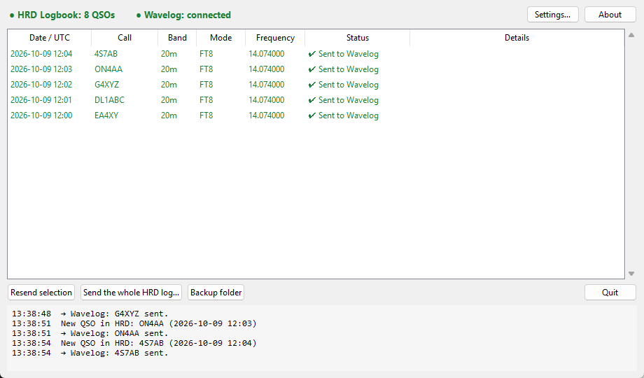

# HRD Logbook ⇄ Wavelog

[](https://github.com/LesF4/hrd-wavelog-bridge/releases/latest)
[](https://github.com/LesF4/hrd-wavelog-bridge/releases)
[](LICENSE)

[🇫🇷 Français](README.md) · 🇬🇧 English

**Automatically keeps your HRD Logbook (Ham Radio Deluxe) and your [Wavelog](https://www.wavelog.org) identical, both ways.**
- Every QSO logged in **HRD** (by hand, from WSJT-X, JS8Call…) goes to **Wavelog** by itself.
- Every QSO added to **Wavelog** elsewhere (radio club, portable outing, contest…) is copied into **HRD** by itself as soon as you're back and HRD is open.

Made by **F4MAJ / Jean-Bernard** for the [Les F4](https://github.com/LesF4) community.



## At a glance

- **For whom?** Hams who keep their log in **HRD Logbook** and also use **Wavelog**, self-hosted or online.
- **Both ways:** HRD → Wavelog as soon as a QSO is logged, Wavelog → HRD every 2 minutes.
- **All modes:** SSB, CW, FT8, JS8…
- **No duplicates:** a QSO that came from HRD never comes back to HRD, and a QSO already on one side is not added twice (same call, same band, within 15 minutes).
- **Nothing is ever deleted:** the app only adds.
- **Catch up on the past:** *Compare both logs…* shows what is missing on each side and adds it in one click.
- **Privacy-friendly:** only QSO details travel. Your contacts' address, e-mail and notes stay in HRD.
- **Nothing gets lost:** Internet down or HRD closed? QSOs wait and go as soon as possible.
- **Bilingual** English / French, **free and open source** (MIT licence).

## Download

Go to [**Releases**](https://github.com/LesF4/hrd-wavelog-bridge/releases/latest) and get **`HRDtoWavelog-Setup-x.y.z.exe`**. It's a regular installer: Start menu, desktop icon, start with Windows, clean uninstall. No admin rights needed. To update, just install the new version over the old one: your settings are kept.

> **First start:** Windows may show "Windows protected your PC" because the app is not signed. Click **More info**, then **Run anyway**. The full source code is right here.

## Step-by-step setup

### 1. Install the app

Run `HRDtoWavelog-Setup-x.y.z.exe` and keep **Create a desktop shortcut** and **Start HRDtoWavelog with Windows** ticked.

### 2. Create an API key in Wavelog

In your web browser, log in to your Wavelog. Open **your account menu** (top right), then **API Keys**. Create a key with **Read & Write** rights and copy it.

### 3. Configure HRD Logbook

In HRD Logbook, **Tools → Configure → QSO Forwarding**:
- **UDP send** (*UDP Send*): enable sending QSOs, address **`127.0.0.1`** (or `localhost`), port **`12060`**. This is how HRD passes each new QSO to the app.
- **UDP receive** (*UDP Receive*): enable receiving QSOs from other programs, port **`2333`**, into your logbook. It's the same box as for WSJT-X or JS8Call, so it may already be ticked. This is how the app adds QSOs coming from Wavelog into HRD.
- **OK**.

### 4. Configure the app

On first start the **Settings** window opens:
- **UDP port**: `12060`, the same as HRD's UDP send.
- **Log file**: found automatically. It is used by *Compare both logs…* and to avoid duplicates.
- **Address**: your Wavelog address, e.g. `https://wavelog.mysite.org`.
- **API key**: paste the key from step 2.
- Click **Test and load stations**, then pick your **station**.
- **Wavelog → HRD** section: keep copying to HRD ticked, **HRD receive** port `2333`, and tick the **stations followed** (your main station, plus your portable station if you have one).
- **Save**.

The app then offers to **compare both logs**. Accept: you'll see whether QSOs are already missing on either side (see below).

### 5. Check

**Both lights at the top of the window must be green.** Log a QSO in HRD: a few seconds later it shows up in the list ✔ and in your Wavelog.

> The app must be **running when you log a QSO in HRD**: HRD sends it only once. That's why starting with Windows is recommended. If QSOs were logged while the app was closed, *Compare both logs…* catches up.

## Usage

Each line in the list shows its **direction**: *HRD → Wavelog* or *Wavelog → HRD*.

| Status | Meaning |
|---|---|
| ✔ **Sent to Wavelog** | The HRD QSO is in your Wavelog. |
| ✔ **Already in Wavelog** | Wavelog already had it, nothing was added. |
| ⬇ **Added to HRD** | The QSO from Wavelog is in your HRD log. |
| ⏳ **Waiting** / **Waiting for HRD** | Wavelog unreachable, or HRD closed: it will be sent automatically. |
| ✖ **Rejected by Wavelog** | The reason is in the *Details* column. Fix the QSO if needed, then **Resend selection**. |

### Compare both logs

**Compare both logs…** reads your HRD log (read-only) and your Wavelog, then shows, date by date, the QSOs missing **in HRD** and those missing **in Wavelog**. You can then click **Add the … QSO(s) to HRD** and/or **Add the … QSO(s) to Wavelog**. Nothing is ever deleted. Handy at the start, after a contest logged elsewhere, or if the app was closed for a while.

QSOs are added to HRD **one at a time**: the app waits until HRD has saved each one before moving on, and a **progress bar** at the bottom of the window shows how far it is (allow a few minutes for 200 QSOs). If Wavelog rejects a QSO, the *Details* column says why: usually a missing band or a duplicate in HRD, to fix in HRD before comparing again.

- The ✕ button hides the app next to the clock without stopping it. Right-click the icon → **Quit**.
- **Backup folder**: `qsos_envoyes_wavelog.adi` keeps an ADIF copy of everything sent to Wavelog.

## Troubleshooting

| Problem | Fix |
|---|---|
| **HRD light red** | The UDP port is already used by another program. Pick another port in *Settings* and set the same one in HRD's UDP send (*QSO Forwarding*). |
| HRD light green but **no QSO reaches Wavelog** | In HRD (*Tools → Configure → QSO Forwarding*), check that UDP **send** is on, to `127.0.0.1`, on the same port as the app. |
| Wavelog QSOs stay **⏳ Waiting for HRD** | HRD Logbook must be open, with UDP **receive** on, on the port shown in *Settings* (`2333` by default). |
| *Compare both logs…* can't find the log | In *Settings*, pick your `.hrdsql` file (usually `Documents\Ham Radio Deluxe\HRD Logbook\`). Only **Local/SQLite** logbooks are supported, the default in recent HRD versions. |
| **Wavelog light red** | Check your Internet connection and the Wavelog address. |
| "invalid API key" / "read-only" | Create a **Read & Write** key in Wavelog and paste it into *Settings*. |
| A QSO edited or deleted afterwards | Only **new** QSOs are synced. Corrections and deletions must be done on both sides. |
| Antivirus blocks it | The app is unsigned, reads your HRD log and talks to the Internet, which can worry some antivirus programs (Bitdefender in particular). Add an exception for `HRDtoWavelog.exe` and allow it in the antivirus firewall. |

Question, bug, idea? Open an [**issue**](https://github.com/LesF4/hrd-wavelog-bridge/issues).

## Where is my data?

In `%APPDATA%\HRDtoWavelog\`:
- `config.json`: your settings, including your API key, which stays on your PC only;
- `history.json`: the list shown in the window;
- `qsos_envoyes_wavelog.adi`: ADIF copy of the QSOs sent to Wavelog.

## Tested with

- HRD Logbook 6.9
- Self-hosted Wavelog
- Windows 11

## How it works (for the curious)

```
HRD Logbook ──(UDP send 12060, "contactinfo" XML)──▶ HRDtoWavelog ──(Wavelog API "qso")──▶ Wavelog
HRD Logbook ◀──(UDP receive 2333, ADIF)── HRDtoWavelog ◀──(Wavelog API "get_contacts_adif", every 2 min)── Wavelog
```

On the HRD side the app only listens and sends locally (`127.0.0.1`). On the Wavelog side it remembers the number of the last QSO fetched and only asks for new ones. Before adding a QSO on one side it checks it isn't already there, and it ignores the "echo" HRD sends back for a QSO the app has just added. Written in Python (tkinter UI). To run from source, run the tests or build the installer, see [`packaging/README.md`](packaging/README.md).

## See also

[**JS8Call → HRD Logbook**](https://github.com/LesF4/js8-hrd-bridge) sends your JS8Call QSOs into HRD. Together with this app, every JS8 QSO lands in HRD and then in Wavelog, hands-free.

## Licence

[MIT](LICENSE) © 2026 **F4MAJ / Jean-Bernard**. You may freely use, copy, modify and share this app, as long as you keep the copyright notice.

73 de F4MAJ!
