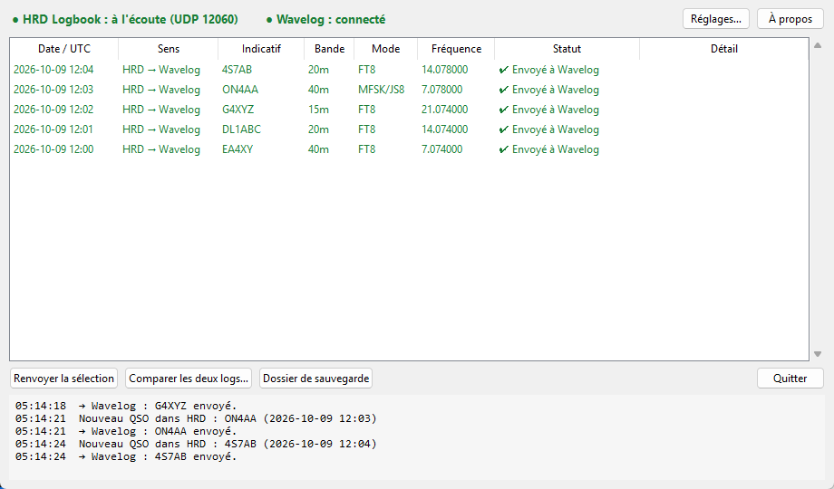
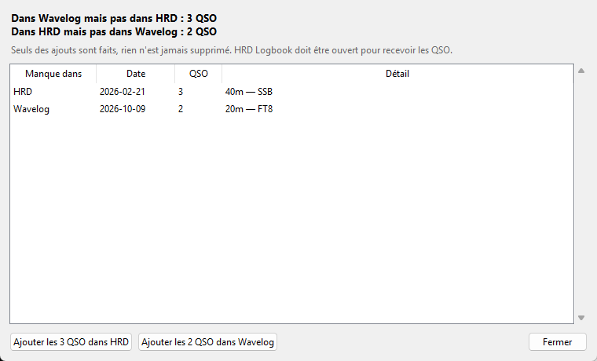

# HRD Logbook ⇄ Wavelog

[](https://github.com/LesF4/hrd-wavelog-bridge/releases/latest)
[](https://github.com/LesF4/hrd-wavelog-bridge/releases)
[](LICENSE)

🇫🇷 Français · [🇬🇧 English](README.en.md)

**Garde automatiquement ton log HRD Logbook (Ham Radio Deluxe) et ton [Wavelog](https://www.wavelog.org) identiques, dans les deux sens.**
- Chaque QSO enregistré dans **HRD** (à la main, depuis WSJT-X, JS8Call…) part tout seul dans **Wavelog**.
- Chaque QSO ajouté dans **Wavelog** ailleurs (radio-club, sortie portable, concours…) est recopié tout seul dans **HRD** dès que tu rentres et que HRD est ouvert.

Créée par **F4MAJ / Jean-Bernard** pour la communauté [Les F4](https://github.com/LesF4).



## En bref

- **Pour qui ?** Les OM qui tiennent leur log dans **HRD Logbook** et utilisent aussi **Wavelog**, hébergé chez eux ou en ligne.
- **Dans les deux sens :** HRD → Wavelog dès l'enregistrement d'un QSO, Wavelog → HRD toutes les 2 minutes.
- **Tous les modes :** phonie, CW, FT8, JS8…
- **Pas de doublons :** un QSO venu de HRD ne revient pas dans HRD, et un QSO déjà présent d'un côté n'y est pas ajouté une deuxième fois (même indicatif, même bande, à 15 minutes près).
- **Rien n'est jamais supprimé :** l'app ne fait que des ajouts.
- **Rattraper le passé :** le bouton *Comparer les deux logs…* montre ce qui manque de chaque côté et l'ajoute en un clic.
- **Respect de la vie privée :** seules les informations du QSO circulent. L'adresse, l'e-mail et les notes de tes correspondants restent dans HRD.
- **Rien ne se perd :** Internet coupé ou HRD fermé ? Les QSO attendent et partent dès que c'est possible.
- **Bilingue** français / anglais, **gratuit et libre** (licence MIT).

## Téléchargement

Va dans les [**Releases**](https://github.com/LesF4/hrd-wavelog-bridge/releases/latest) et prends **`HRDtoWavelog-Setup-x.y.z.exe`**. C'est un installeur classique : menu Démarrer, icône sur le bureau, lancement avec Windows, désinstallation propre. Pas besoin d'être administrateur. Pour mettre à jour, installe simplement la nouvelle version par-dessus : tes réglages sont conservés.

> **Premier lancement :** Windows peut afficher « Windows a protégé votre ordinateur », parce que l'application n'est pas signée. Clique sur **Informations complémentaires** puis **Exécuter quand même**. Le code source est entièrement visible ici.

## Installation pas à pas

### 1. Installer l'application

Lance `HRDtoWavelog-Setup-x.y.z.exe` et laisse cochées **Créer une icône sur le bureau** et **Lancer HRDtoWavelog au démarrage de Windows**.

### 2. Créer une clé API dans Wavelog

Dans ton navigateur, connecte-toi à ton Wavelog. Ouvre le **menu de ton compte** (en haut à droite), puis **API Keys**. Crée une clé avec les droits **Read & Write** et copie-la.

### 3. Régler HRD Logbook

Dans HRD Logbook, menu **Tools → Configure → QSO Forwarding** :
- **envoi UDP** (*UDP Send*) : coche l'envoi des QSO, adresse **`127.0.0.1`** (ou `localhost`), port **`12060`**. C'est ainsi que HRD transmet chaque nouveau QSO à l'app.
- **réception UDP** (*UDP Receive*) : coche la réception des QSO envoyés par d'autres programmes, port **`2333`**, vers ton logbook. C'est la même case que pour WSJT-X ou JS8Call : elle est peut-être déjà cochée. C'est ainsi que l'app ajoute dans HRD les QSO venus de Wavelog.
- **OK**.

### 4. Régler l'application

Au premier lancement, la fenêtre **Réglages** s'ouvre :
- **Port UDP** : `12060`, le même que l'envoi UDP de HRD.
- **Fichier du log** : trouvé tout seul. Il sert à *Comparer les deux logs…* et à éviter les doublons.
- **Adresse** : l'adresse de ton Wavelog, par exemple `https://wavelog.monsite.fr`.
- **Clé API** : colle la clé de l'étape 2.
- Clique sur **Tester et charger les stations**, puis choisis ta **station**.
- Partie **Wavelog → HRD** : laisse cochée la copie dans HRD, port de **réception HRD** `2333`, et coche les **stations suivies** (ta station principale, plus ta station portable si tu en as une).
- **Enregistrer**.

L'app te propose alors de **comparer les deux logs**. Accepte : tu verras s'il manque déjà des QSO d'un côté ou de l'autre (voir plus bas).

### 5. Vérifier

Les **deux voyants en haut de la fenêtre doivent être verts**. Enregistre un QSO dans HRD : quelques secondes plus tard, il apparaît dans la liste ✔ et dans ton Wavelog.

> L'application doit être **lancée au moment où tu enregistres un QSO dans HRD** : HRD ne l'envoie qu'une fois. C'est pourquoi le lancement avec Windows est recommandé. Si des QSO ont été enregistrés pendant que l'app était fermée, *Comparer les deux logs…* les rattrape.

## Utilisation

Chaque ligne de la liste indique son **sens** : *HRD → Wavelog* ou *Wavelog → HRD*.

| Statut | Signification |
|---|---|
| ✔ **Envoyé à Wavelog** | Le QSO de HRD est dans ton Wavelog. |
| ✔ **Déjà dans Wavelog** | Wavelog l'avait déjà, rien n'a été ajouté. |
| ⬇ **Ajouté dans HRD** | Le QSO venu de Wavelog est dans ton log HRD. |
| ⏳ **En attente** / **En attente de HRD** | Wavelog injoignable, ou HRD fermé : il partira tout seul. |
| ✖ **Refusé par Wavelog** | La raison est dans la colonne *Détail*. Corrige le QSO si besoin, puis **Renvoyer la sélection**. |

### Comparer les deux logs



Le bouton **Comparer les deux logs…** lit ton log HRD (en lecture seule) et ton Wavelog, puis affiche, date par date, les QSO qui manquent **dans HRD** et ceux qui manquent **dans Wavelog**. Tu peux alors cliquer sur **Ajouter les … QSO dans HRD** et/ou **Ajouter les … QSO dans Wavelog**. Rien n'est jamais supprimé. Pratique au départ, après un concours saisi ailleurs, ou si l'app a été fermée un moment.

Les QSO sont ajoutés dans HRD **un par un** : l'app attend que HRD ait enregistré chacun avant de passer au suivant, et une **barre de progression** en bas de la fenêtre montre l'avancement (compte quelques minutes pour 200 QSO). Si un QSO est refusé par Wavelog, la colonne *Détail* en donne la raison : le plus souvent, une bande manquante ou un doublon dans HRD, à corriger dans HRD avant de relancer la comparaison.

- La croix ✕ range l'application près de l'horloge sans l'arrêter. Clic droit sur l'icône → **Quitter**.
- **Dossier de sauvegarde** : le fichier `qsos_envoyes_wavelog.adi` garde une copie ADIF de tout ce qui a été envoyé à Wavelog.

## En cas de souci

| Problème | Solution |
|---|---|
| Voyant **HRD rouge** | Le port UDP est déjà utilisé par un autre programme. Choisis un autre port dans *Réglages* et mets le même dans l'envoi UDP de HRD (*QSO Forwarding*). |
| Le voyant HRD est vert mais **aucun QSO n'arrive dans Wavelog** | Vérifie dans HRD (*Tools → Configure → QSO Forwarding*) que l'**envoi** UDP est activé, vers `127.0.0.1`, sur le même port que l'app. |
| Les QSO de Wavelog restent **⏳ En attente de HRD** | HRD Logbook doit être ouvert, avec la **réception** UDP activée sur le port indiqué dans *Réglages* (`2333` par défaut). |
| *Comparer les deux logs…* ne trouve pas le log | Dans *Réglages*, choisis ton fichier `.hrdsql` (en général `Documents\Ham Radio Deluxe\HRD Logbook\`). Seuls les logbooks **Local/SQLite** sont pris en charge, c'est le format par défaut des versions récentes de HRD. |
| Voyant **Wavelog rouge** | Vérifie ta connexion Internet et l'adresse de Wavelog. |
| « clé API invalide » / « lecture seule » | Crée une clé **Read & Write** dans Wavelog et colle-la dans *Réglages*. |
| Un QSO modifié ou supprimé après coup | Seuls les **nouveaux** QSO sont synchronisés. Une correction ou une suppression est à faire des deux côtés. |
| Antivirus qui bloque | L'app n'est pas signée, lit ton log HRD et communique avec Internet, ce qui peut inquiéter certains antivirus. **Bitdefender** l'avait signalée à tort : après analyse, il a reconnu la fausse alerte et l'a corrigée dans ses signatures (octobre 2026). Mets ton antivirus à jour. Si un antivirus la bloque encore, ajoute une exception pour `HRDtoWavelog.exe` et autorise-le dans son pare-feu. |

Une question, un bug, une idée ? Ouvre une [**issue**](https://github.com/LesF4/hrd-wavelog-bridge/issues).

## Où sont mes données ?

Dans `%APPDATA%\HRDtoWavelog\` :
- `config.json` : tes réglages, dont ta clé API, qui reste uniquement sur ton PC ;
- `history.json` : la liste affichée dans la fenêtre ;
- `qsos_envoyes_wavelog.adi` : la copie ADIF des QSO envoyés à Wavelog.

## Testé avec

- HRD Logbook 6.9
- Wavelog auto-hébergé
- Windows 11

## Comment ça marche (pour les curieux)

```
HRD Logbook ──(envoi UDP 12060, XML « contactinfo »)──▶ HRDtoWavelog ──(API Wavelog « qso »)──▶ Wavelog
HRD Logbook ◀──(réception UDP 2333, ADIF)── HRDtoWavelog ◀──(API Wavelog « get_contacts_adif », toutes les 2 min)── Wavelog
```

L'app n'écoute et n'envoie qu'en local (`127.0.0.1`) côté HRD. Côté Wavelog, elle retient le numéro du dernier QSO récupéré et ne demande que les nouveaux. Avant d'ajouter un QSO d'un côté, elle vérifie qu'il n'y est pas déjà, et elle ignore l'« écho » renvoyé par HRD pour un QSO qu'elle vient d'y ajouter. Le code est en Python (interface tkinter). Pour lancer depuis les sources, lancer les tests ou construire l'installeur : voir [`packaging/README.md`](packaging/README.md).

## Voir aussi

[**JS8Call → HRD Logbook**](https://github.com/LesF4/js8-hrd-bridge) envoie tes QSO JS8Call dans HRD. Associé à cette application, chaque QSO JS8 arrive dans HRD puis dans Wavelog, sans rien faire.

## Licence

[MIT](LICENSE) © 2026 **F4MAJ / Jean-Bernard**. Tu peux librement utiliser, copier, modifier et partager cette application, à condition de conserver la mention de copyright.

73 de F4MAJ !
